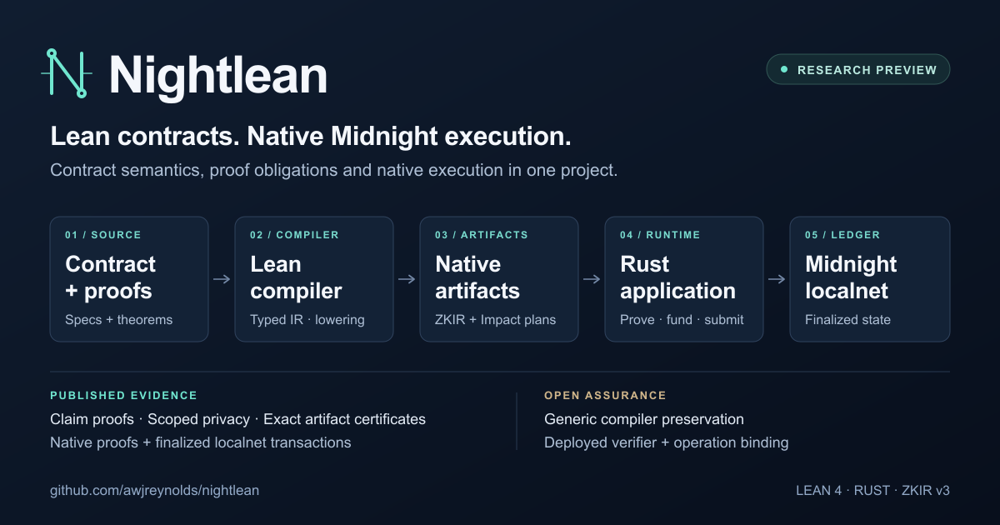

<p align="center">
  
</p>

<p align="center">
  <a href="#try-the-compiler">Quick start</a> ·
  <a href="docs/README.md">Documentation</a> ·
  <a href="docs/designs/architecture.md">Architecture &amp; assurance</a> ·
  <a href="https://github.com/awjreynolds/nightlean/issues/1">Roadmap</a>
</p>

<p align="center">
  <a href="https://github.com/awjreynolds/nightlean/actions/workflows/ci.yml"></a>
</p>

Nightlean is a Lean 4 compiler and native runtime for Midnight private contracts. Write circuit relations and ledger transitions in a typed Lean DSL, state their properties with ordinary Lean theorems, and compile directly to native ZKIR and Impact plans.

The compiler and primary lowering are written in Lean. The Rust application path handles proving, funding, submission and recovery without Node. No Compact compiler or runtime dependency sits between your source and the native backend.

**Research preview, with published proofs and finalized localnet runs.** The current private-claim workload has source correctness proofs, claim-specific native preservation proofs and scoped privacy proofs. Exact byte/build certificates now join those proofs to the retained claim artifacts. Whole-compiler correctness and deployed verifier binding remain open.

Lean serves two roles: a finite language for compilable contracts and a full proof language for specifications and theorems. Circuit constraints and ledger state effects stay separate, so each has an explicit semantics and assurance boundary. See the [architecture overview](docs/designs/architecture.md).

## Try the compiler

Install [elan](https://github.com/leanprover/elan#installation) and Git. Elan selects the repository's pinned Lean **4.35.0** toolchain. Run:

```sh
git clone https://github.com/awjreynolds/nightlean.git
cd nightlean
lake build
lake exe nightlean check examples/PrivateClaim.lean
lake exe nightlean compile examples/PrivateClaim.lean --output build/claim
```

The output includes the standalone `claimRelation.zkir`, contract-call `PrivateClaim.claim.zkir`, runtime plan `PrivateClaim.claim.impact.json`, and `nightlean.json` manifest. This compiler workflow needs no Rust, Node or running chain. Compile trusted Lean source: imports and elaborators execute development code.

For native proofs and transactions, follow the [Rust client guide](docs/development/native-client.md), [retained artifact workflow](docs/development/portable-artifacts.md) and [pinned native toolchain setup](docs/development/native-toolchain.md). Those paths add Rust, native build tools, proving parameters and an isolated localnet. The [JavaScript development harness](docs/development/native-contract.md) is an optional reproducibility path.

## A small, real example

This circuit from [`examples/BoundedScalars.lean`](examples/BoundedScalars.lean) constrains the sum of two private 8-bit values to a public result:

```lean
import Nightlean.Frontend
open scoped Nightlean

nightlean_circuit boundedRelation where
  public expected : UIntRange 511
  private left : UInt 8
  private right : UInt 8
  let sum : UIntRange 511 := add(left, right)
  assert eq(sum, expected)
  output result : UIntRange 511 := expected
end
```

The full example writes the result to a ledger cell. [`PrivateClaim.lean`](examples/PrivateClaim.lean) adds a private Merkle path, a public nullifier and state updates which reject reuse. Its [proofs import the actual source](docs/development/private-claim-proofs.md).

## Evidence, with boundaries

| Published result | What the evidence establishes |
| --- | --- |
| [Source correctness and privacy](docs/development/private-claim-proofs.md) | Claim eligibility equations, exact state updates, invariants, framing and replay rejection. Six source mutations break their expected proof clauses. Privacy compares successful runs under a declared public-observation policy. |
| [Typed proof audit](docs/development/proof-registration.md) | Exact obligation and model checks, fresh Lean kernel replay, and a transitive axiom policy. Functional and privacy obligations are separate. |
| [Native relation](docs/development/private-claim-lowering-proofs.md) and [state preservation](docs/development/private-claim-native-state-proofs.md) | Claim-specific soundness for arbitrary satisfying assignments and checked VM traces, source completeness, and certificates for the emitted JSON trees. |
| [Native privacy](docs/development/private-claim-native-privacy-proofs.md) | Equal public native observations for successful claim executions under explicit host-context and implementation assumptions. Proof bytes, failures, logs and timing are outside the observer. |
| [Exact artifact certificates](docs/development/private-claim-artifact-certificates.md) | Independent immutable-source builds, kernel checks of retained raw bytes, and functional/privacy composition. Eight stale-binding mutations reject. |
| [Rust client qualification](docs/development/native-client.md#retained-qualification) | Real proofs, funded deployment and claim submission, finalized state checks, and durable recovery on both selected 3.2.0 and 3.2.1 profiles. |
| [Bounded scalars](docs/development/unsigned-localnet.md) | Finalized deployment and call, exact predicted state, and 34 adversarial witness cases against both native checker profiles. |

Lean checks the stated theorems. Localnet receipts establish tested integration behavior. Neither establishes a universally verified compiler or a production-ready contract. Native cryptography, parser/VM agreement, host behavior and the remaining deployment links stay explicit [trust boundaries](docs/designs/architecture.md#assurance-boundaries).

## Direction and contributions

The destination is [full native ZKIR v3 and Midnight ledger capability coverage](docs/compatibility/GOAL.md). Compact feature equivalence is a minimum comparison, not the scope limit.

Today: `Native`, `Bool`, bounded unsigned scalars, typed helpers, scalar disclosure checks, and lazy host control. Checked composite layouts and codecs are present. Aggregate source effects, native guarded execution, broader ledger composition and mobile/WASM bindings remain open.

Start with the [public issue map](https://github.com/awjreynolds/nightlean/issues/1) and [contribution guide](CONTRIBUTING.md). The [documentation index](docs/README.md) connects authoring, runtime integration, proof reproduction and capability research.

[MIT license](LICENSE) · [Security reporting](SECURITY.md) · [Shareable project card](docs/README.md#project-visual)
