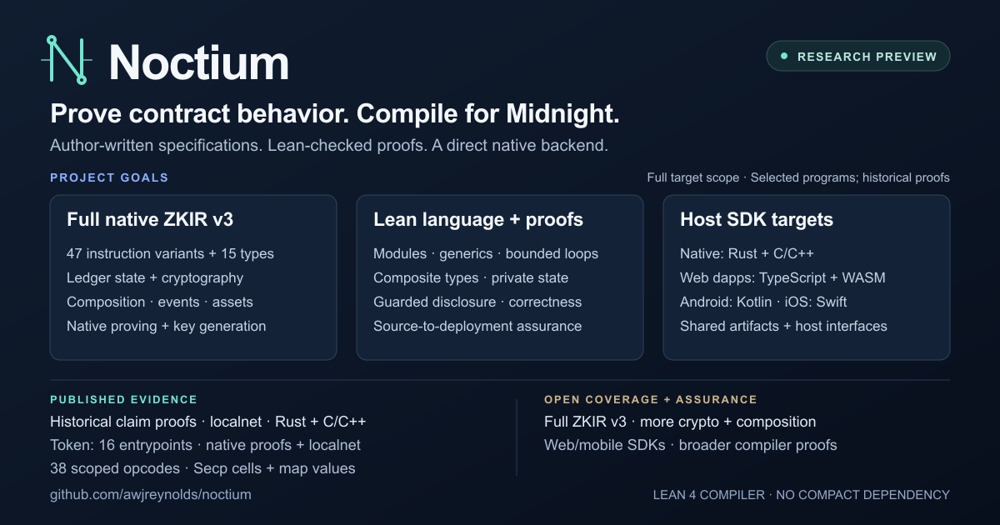

<p align="center">
  
</p>

<p align="center">
  <a href="#try-the-compiler">Quick start</a> ·
  <a href="docs/README.md">Documentation</a> ·
  <a href="docs/assets/noctium-capabilities.png">Capability goals</a> ·
  <a href="docs/designs/architecture.md">Architecture &amp; assurance</a> ·
  <a href="https://github.com/awjreynolds/noctium/issues/1">Roadmap</a>
</p>

<p align="center">
  <a href="https://github.com/awjreynolds/noctium/actions/workflows/ci.yml"></a>
</p>

Noctium is a Lean 4 compiler and proof framework for Midnight private contracts. Define the behavior your contract must satisfy, prove those properties against the actual source, and compile directly to Midnight's native formats.

- **Write** circuit constraints and ledger transitions in a typed Lean DSL.
- **Specify and prove** correctness, invariants and scoped privacy with ordinary Lean theorems and tactics.
- **Compile and execute** through native ZKIR circuits, Impact ledger plans and a Rust client for proving, funding, submission and recovery.

The compiler and primary lowering are written in Lean. Contract execution uses a finite supported subset. Proof authoring uses Lean's full theorem language. The Rust and C/C++ application paths need no Node, and Noctium has no Compact compiler or runtime dependency.

**Research preview.** The private-claim example has source correctness, native preservation and scoped privacy proofs, joined to exact retained artifacts by byte/build certificates. These are claim-specific guarantees. The selected claim has deployed verifier binding. Generic scalar lowering has soundness and source-completeness proofs. Frontend, broader circuit and ledger preservation remain open. See [what is proved and what is trusted](docs/designs/architecture.md#assurance-boundaries).

## Try the compiler

Install [elan](https://github.com/leanprover/elan#installation) and Git. Elan selects the repository's pinned Lean **4.35.0** toolchain. Run:

```sh
git clone https://github.com/awjreynolds/noctium.git
cd noctium
lake build
lake exe noctium check examples/PrivateClaim.lean
lake exe noctium compile examples/PrivateClaim.lean --output build/claim
```

The output includes the standalone `claimRelation.zkir`, contract-call `PrivateClaim.claim.zkir`, runtime plan `PrivateClaim.claim.impact.json`, and `nightlean.json` manifest. This compiler workflow needs no Rust, Node or running chain. Compile trusted Lean source: imports and elaborators execute development code.

For native proofs and transactions, follow the [Rust client guide](docs/development/native-client.md) or [C/C++ client ABI](docs/development/native-client-abi.md), [retained artifact workflow](docs/development/portable-artifacts.md) and [pinned native toolchain setup](docs/development/native-toolchain.md). Those paths add Rust, native build tools, proving parameters and an isolated localnet. The [JavaScript development harness](docs/development/native-contract.md) is an optional reproducibility path.

Legacy technical identifiers such as `Nightlean.Frontend`, `nightlean_*` and `nightlean.json` stay stable for proof and artifact compatibility. Historical receipts retain the former Nightlean name.

## A small, real example

This circuit from [`examples/BoundedScalars.lean`](examples/BoundedScalars.lean) constrains the sum of two private 8-bit values to a public result:

```lean
import Nightlean.Frontend
open scoped Nightlean

nightlean_circuit boundedRelation where
  public expected : UIntRange 511
  private left : UInt 8
  private right : UInt 8
  let sum : UIntRange 511 := add(left, right)
  assert eq(sum, expected)
  output result : UIntRange 511 := expected
end
```

The full example writes the result to a ledger cell. [`PrivateClaim.lean`](examples/PrivateClaim.lean) adds a private Merkle path, a public nullifier and state updates which reject reuse. Its [proofs import the actual source](docs/development/private-claim-proofs.md).

## What is proved

Lean theorems establish specified contract properties. Runtime zero-knowledge proofs establish satisfaction of the emitted circuit and bound statement. The preservation proofs and artifact certificates below connect source properties to native artifacts for the qualified private claim.

| Published result | What the evidence establishes |
| --- | --- |
| [Source behavior](docs/development/private-claim-proofs.md) | Eligibility equations, exact state updates, invariants, framing and replay rejection. Six source mutations invalidate their expected proof clauses. |
| [Proof audit](docs/development/proof-registration.md) | Exact theorem/model checks, fresh-kernel replay and transitive axiom checks. Functional and privacy obligations stay separate. |
| [Native relation](docs/development/private-claim-lowering-proofs.md) and [state](docs/development/private-claim-native-state-proofs.md) | Claim-specific soundness for arbitrary satisfying assignments and checked VM traces, source completeness and transcript preservation. |
| [Scoped privacy](docs/development/private-claim-native-privacy-proofs.md) | Equal public native observations for successful claim executions under explicit assumptions. Proof bytes, failures, logs and timing are excluded. |
| [Exact artifacts](docs/development/private-claim-artifact-certificates.md) | Independent immutable-source builds and kernel checks bind the claim's functional/privacy proofs to retained raw bytes. |
| [Deployed claim identity](docs/development/private-claim-deployment-audit.md) | Public-only auditing joins the pinned source certificate, native key generation, initialized state and finalized operation under explicit trusted-node assumptions. |
| [Generic scalar lowering](docs/research/generic-scalar-preservation.md) | Soundness and source completeness for the actual scalar lowerer, with arbitrary native witnesses, explicit typed input/hash premises and independently pinned two-role kernel auditing. |
| [Native integration tests](docs/development/native-client.md#retained-qualification) | Real ZK proofs, funded transactions, finalized state checks and recovery on both 3.2.0 and 3.2.1 profiles. [Bounded scalar tests](docs/development/unsigned-localnet.md) add 34 adversarial witness cases. |

Native cryptography, parser/VM agreement, host behavior and authenticated authority inputs remain [trusted boundaries](docs/designs/architecture.md#assurance-boundaries). Localnet receipts provide integration evidence. They do not establish generic compiler correctness or production readiness.

## Direction and contributions

The destination is [full native ZKIR v3 and Midnight ledger capability coverage](docs/compatibility/GOAL.md). Compact feature equivalence is a minimum comparison, not the scope limit.

SDK goals cover native Rust/C/C++, TypeScript with WASM for web dapps, Kotlin for Android and Swift for iOS. Rust and C/C++ have qualified private-claim proof, transaction and recovery evidence on localnet. Web/mobile packages and general source witness execution remain goals.

Today: `Native`, `Bool`, bounded unsigned scalars, typed helpers, [bounded type and natural specialization](docs/development/generics.md), scalar and component disclosure checks, and lazy host control. Checked composite layouts and codecs are present. [Source helper outputs](docs/development/component-disclosure.md) flatten checked composite results into native circuit leaves. Aggregate ledger effects, native guarded execution and broader composition remain open. Explore the [full capability goals graphic](docs/assets/noctium-capabilities.png).

Start with the [public issue map](https://github.com/awjreynolds/noctium/issues/1) and [contribution guide](CONTRIBUTING.md). The [documentation index](docs/README.md) connects authoring, runtime integration, proof reproduction and capability research.

[MIT license](LICENSE) · [Security reporting](SECURITY.md) · [Shareable project card](docs/README.md#project-visual)
