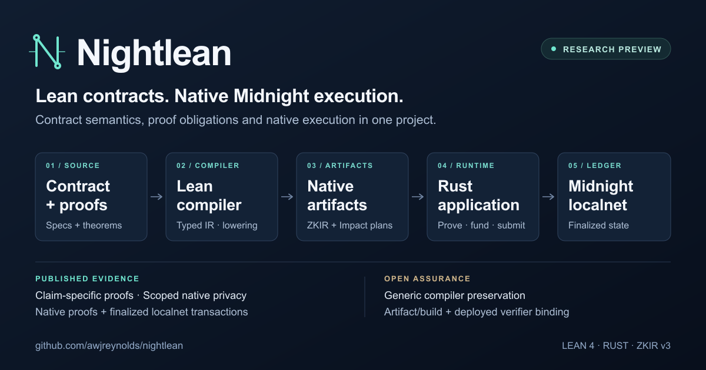

# Architecture and assurance

Nightlean places the contract language, typed intermediate representation, reference semantics and primary native lowering in Lean 4. Contract authors use a finite circuit DSL and ordinary Lean specifications, theorems and tactics. The proof language is broader than the executable contract subset.

## Four boundaries

**Source.** A circuit relates public inputs, private witnesses and outputs. A contract separately declares state cells, maps, reads, guards and writes around an entrypoint. The [private claim](../../examples/PrivateClaim.lean) uses a two-level Merkle path and records a nullifier to reject reuse. The workload exercises the architecture without defining its permanent scope.

**Lean compiler.** Elaboration produces typed circuit and contract IR. Validation checks the supported target profile. The [scalar disclosure pass](../development/disclosure.md) tracks private origins at public sinks. A [proved pruning pass](../development/assurance.md#kernel-checked-compiler-transformation) removes true constraints without changing reference behavior. Native lowering emits relations and plans, and the [producer gate](../development/native-producer-safety.md) rejects unsupported or invalid scalar descriptors.

**Native artifacts.** ZKIR v3 relations describe proof constraints. Impact plans describe native ledger operations, state layout and ordered reads. A retained public bundle binds the artifacts, selected profile and keys through an authenticated manifest. [Bundle verification](../development/portable-artifacts.md) is a runtime integrity mechanism. A complete formal certificate from reviewed source through exact bytes and deployed keys is still open.

**Native application.** The Rust runtime executes plans through explicit host capabilities. The assembler constructs native intents. The proof API verifies the frozen statement before attaching a proof, and the [client](../development/native-client.md) funds, seals, submits and validates finalized results. Private journals support recovery and versioned compare-and-exchange. Chain acceptance and private-store commit are distinct outcomes. The [C/C++ ABI](../development/native-runtime-abi.md) exposes runtime execution and providers. The full transaction ABI and mobile/WASM bindings remain separate work.

The application path needs no Node or Compact runtime. Independent Midnight libraries and the pinned native ZKIR toolchain supply proving and ledger interfaces. Optional JavaScript tools remain for development orchestration and selected conformance checks.

## Assurance boundaries

The strongest published formal results concern the actual private-claim program. They connect its imported source definitions to independent native relation and state models. Soundness quantifies over arbitrary satisfying assignments and checked VM traces, rather than assuming an honest witness generator.

| Layer | Established today | Remaining boundary |
| --- | --- | --- |
| [Source properties](../development/private-claim-proofs.md) | Eligibility equations, exact updates, invariants, framing, replay rejection and scoped source privacy | Correctness of the intended business specification and stated hash assumptions |
| [Proof audit](../development/proof-registration.md) | Typed obligation matching, pinned model comparison, fresh-kernel replay and transitive axiom checks | Independent specification review and authenticated release provenance |
| [Native relation](../development/private-claim-lowering-proofs.md) and [state](../development/private-claim-native-state-proofs.md) | Claim-specific soundness, completeness, state/transcript preservation and JSON-tree certificates | Exact byte parsing/build qualification, native implementation agreement and real admission limits |
| [Native privacy](../development/private-claim-native-privacy-proofs.md) | Equal declared public observations for successful runs with coupled host context | Proof-byte zero knowledge, failure channels, timing, logs and provider observations |
| [Native integration](../development/native-client.md#retained-qualification) | Real proofs, finalized localnet execution, state comparison and recovery tests | General feature coverage, public-network qualification and independent security review |

Fresh-kernel audits admit only the pinned foundational axioms `propext`, `Classical.choice` and `Quot.sound`. Replay alone does not enforce this policy. The checker also examines transitive dependencies and exact theorem statements.

The kernel checks the modeled propositions. Native parser, hash, VM, proof-system and host implementations retain explicit agreement assumptions. The scoped privacy theorem does not prove cryptographic secrecy of proof bytes or hide success versus failure. Functional correctness supplies no automatic confidentiality guarantee.

Three open links deserve particular attention: [exact artifact/build qualification](https://github.com/awjreynolds/nightlean/issues/56), [deployed key and operation binding](https://github.com/awjreynolds/nightlean/issues/57), and [generic scalar compiler preservation](https://github.com/awjreynolds/nightlean/issues/64). The artifact certificate has a [published implementation checkpoint](../development/private-claim-artifact-certificates.md), with immutable-build qualification still pending. Broader native features need their own preservation evidence. `compiledContractVerified` stays false until the required chain is established.

## Scope and growth

The current source slice includes `Native`, `Bool`, bounded unsigned scalars, [typed helpers](../development/named-helpers.md) and [lazy host control](../development/structured-control.md). Host control does not enable guarded native circuit or ledger execution. Composite layouts and codecs have checked foundations, but aggregate source effects still await component disclosure analysis.

The [capability goal](../compatibility/GOAL.md) follows the full native ZKIR v3 and ledger interfaces. Compact supplies comparison cases and compiler engineering lessons, with no compiler or runtime dependency. [Capability inventories](../compatibility/zkir-feature-matrix.json) track the target surface separately from implemented and qualified source features.

For implementation order and active work, use the [public issue map](https://github.com/awjreynolds/nightlean/issues/1). For reproducible checks, start at the [documentation index](../README.md).
