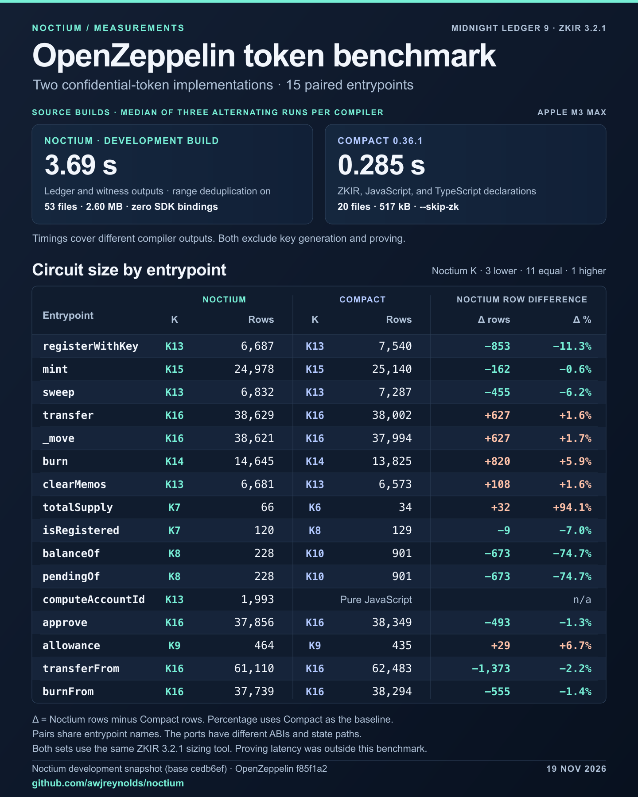

# OpenZeppelin confidential-token compilation benchmark

The 2026-11-18 baseline compares Noctium with Compact. The 2026-11-19 follow-up measures the effect of removing a repeated Lean frontend pass.



## Source compilation

Apple M3 Max, 16 logical cores, 48 GiB RAM. Compilers were prebuilt, dependencies were warm, each run used a fresh process and output directory. Setup/download time, key generation, proving and deployment are excluded.

| Compiler | Three runs (seconds) | Median | Peak observed RSS |
| --- | --- | --- | --- |
| Noctium `adbc42c`, Lean 4.35.0 | 61.350 / 61.811 / 62.504 | 61.811 s | 1.50 GiB |
| Compact 0.36.1, `--skip-zk` | 0.277 / 0.255 / 0.255 | 0.255 s | 0.260 GiB |

These timings cover source processing and emitted artifacts. Noctium emits 16 native entrypoint relations, 13 standalone helper relations, Impact plans and witness/metadata sidecars. Compact emits 15 provable relations, one pure JavaScript function (`computeAccountId`), JavaScript/types and metadata. The workloads have comparable functions but different input/result layouts, explicit state-candidate handling and artifact sets. This is not a proven semantic/ABI equivalence benchmark.

## Single-pass Noctium follow-up

| OpenZeppelin port, ZKIR 3.2.1 | Wall | User CPU | System CPU |
| --- | ---: | ---: | ---: |
| Two Lean passes, `7643dc6` | 65.94 s | 62.96 s | 1.40 s |
| One Lean pass | 41.29 s | 39.51 s | 0.71 s |
| One Lean pass and witness compilation reuse | 38.90 s | 35.46 s | 0.83 s |

The combined changes saved 27.04 seconds (41%) in one matched run per version on the same M3 Max. The exporter reused 10 compiled witness plans when binding them to ledger entrypoint relations. All three runs generated 93 byte-identical files totaling 7,697,562 bytes. The CLI publishes the bundle directory after Lean exits successfully with a manifest. A late source error or early exit leaves no output directory or staging files, and a nonempty destination stays untouched. [Optimization issue](https://github.com/awjreynolds/noctium/issues/85)

## Reuse the Impact plan during export

The exporter now writes the Impact plan returned by the checked ZKIR lowerer. The native producer still derives its expected schedule independently from the pruned source. This removes one repeat of Impact lowering for each of the port's 16 entrypoints.

One before-and-after pair on the same M3 Max emitted all 93 files byte for byte, totaling 7,697,562 bytes. The baseline at `8a697a1` used 34.79 s of user CPU and the revised exporter used 34.72 s. Elapsed time was 41.76 s and 36.32 s respectively. The near-identical user CPU and the single pair leave the speedup unestablished. Identical relations preserve the existing K values. [Circuit-size issue](https://github.com/awjreynolds/noctium/issues/74)

## Exact range-check deduplication

The initial `--dedup-range-checks` pass kept the first unconditional check for each SSA operand and width. On the OpenZeppelin port, it removed 402 repeated checks across 11 of 29 emitted relations. Impact plans matched byte for byte. Witness bindings referenced the corresponding relation in each build.

| Changed entrypoint, ZKIR 3.2.1 | Checks removed | Default rows | Deduplicated rows | K in both builds |
| --- | ---: | ---: | ---: | ---: |
| `_move` | 42 | 41,779 | 39,175 | 16 |
| `approve` | 50 | 41,575 | 38,475 | 16 |
| `burn` | 20 | 16,323 | 15,083 | 14 |
| `burnFrom` | 27 | 39,122 | 38,258 | 16 |
| `transfer` | 42 | 41,787 | 39,183 | 16 |
| `transferFrom` | 41 | 63,125 | 61,813 | 16 |

The pinned `mock-compile` measured 2.1% to 7.6% fewer rows across these entrypoints. The pinned native checker gave the same results for 34 scalar cases in both modes, including acceptance at 255 and rejection at 256 when narrowing to eight bits. One serial full compile per mode took 36.57 and 35.69 seconds respectively, with nearly identical CPU time. These runs did not measure proving time. Generate fresh proving and verifier keys for any changed relation. [Circuit-size issue](https://github.com/awjreynolds/noctium/issues/74)

The current opt-in pass also removes a wider check when an earlier unconditional check already constrains the same operand. On this port, seven more 248-bit checks follow a 128-bit check on the same value. The pass removes 409 checks in total across 11 relations. Pinned synthesis reports 62 fewer rows in each affected ledger entrypoint (`_move`, `approve`, `burn` and `transfer`). For example, `transfer` drops from 39,183 to 39,121 rows and stays at K16. Impact files remain byte-identical and all 34 raw-witness cases agree with the default compiler.

## Selected ledger outputs

One serial run per mode on the same host compared a full compile with `--emit ledger --emit witness`. Both runs used the same executable, source and ZKIR 3.2.1 profile.

| Compiler outputs | Wall | User CPU | System CPU | Files | Bytes |
| --- | ---: | ---: | ---: | ---: | ---: |
| All | 35.64 s | 34.79 s | 0.68 s | 93 | 7,697,562 |
| Ledger and witness | 32.21 s | 31.42 s | 0.62 s | 53 | 5,868,886 |

The selected run saved 3.43 seconds (9.6%) and 1,828,676 bytes (23.8%). It retained all 16 entrypoints and ten ledger witness pairs. ZKIR and witness bytes matched. The selected plans removed only the unused standalone file property. The compiler manifest records the emitted paths and roles. [Compiler output roles](portable-artifacts.md#select-compiler-outputs)

## What the timing includes

The older Noctium baseline ran two complete Lean frontend passes. The first checked the source. The second elaborated it again and exported artifacts. The follow-up times these workflows end to end.

The token source declares no contract theorems. Neither timed command generates cryptographic ZK proofs or keys. Lean theorem checking and transaction ZK proof generation are separate operations. This benchmark does not establish functional correctness of the contract or compiler.

## Contract size and functionality

The [Noctium port](../../examples/openzeppelin/ConfidentialToken.lean) contains 1,013 physical lines, 967 nonblank lines excluding full-line comments, 16 entrypoints, 12 public state slots, two private cells and 13 witness/circuit definitions. These source counts exclude imported compiler/library implementation.

The exact [OpenZeppelin wrapper](https://github.com/OpenZeppelin/compact-contracts/blob/f85f1a23685c6bbedfc8c2589ae3aa128aff7c46/contracts/test/integration/_mocks/ComposedConfidentialFungibleTokenPublicSupply.compact) contains 144 lines and imports the 1,512-line [token module](https://github.com/OpenZeppelin/compact-contracts/blob/f85f1a23685c6bbedfc8c2589ae3aa128aff7c46/contracts/src/token/ConfidentialFungibleToken.compact), the public-supply extension and crypto helpers. Comparing only the 144-line wrapper with the full Lean file would misrepresent source size.

The workload includes ElGamal encrypted balances on Jubjub, pending credits, ECDH memos, account/key registration, transfers, sweeping, mint/burn, delegated escrow spending, allowances, counters, nested maps/lists and private wallet witnesses. The existing isolated-localnet scenario covers all sixteen entrypoints. Nominal ABI and composition qualifications remain separate.

## Native circuit sizes

Both artifact sets were sized using the same pinned native ZKIR 3.2.1 implementation, revision `7a51b3385bbf4bce3604df87a7c70867c9ab43c0`. Its executable banner still says 3.2.0; the recorded source pin and binary SHA identify the selected patch. Sizing uses `mock-compile`, which builds the circuit model without generating keys or proofs.

K belongs to each entrypoint circuit. This contract does not measure K20. Noctium reaches K16, with a largest circuit of 63,125 rows. Source compile time is measured for the entire file, so it cannot be divided into trustworthy per-entrypoint compilation times.

| Entrypoint | Noctium K | Noctium rows | Compact K | Compact rows |
| --- | ---: | ---: | ---: | ---: |
| `registerWithKey` | 13 | 6,932 | 13 | 7,540 |
| `mint` | 15 | 25,236 | 15 | 25,140 |
| `sweep` | 13 | 7,076 | 13 | 7,287 |
| `transfer` | 16 | 41,787 | 16 | 38,002 |
| `_move` | 16 | 41,779 | 16 | 37,994 |
| `burn` | 14 | 16,323 | 14 | 13,825 |
| `clearMemos` | 13 | 6,924 | 13 | 6,573 |
| `totalSupply` | 7 | 66 | 6 | 34 |
| `isRegistered` | 7 | 120 | 8 | 129 |
| `balanceOf` | 9 | 267 | 10 | 901 |
| `pendingOf` | 9 | 267 | 10 | 901 |
| `computeAccountId` | 13 | 2,085 | pure JS | no proof circuit |
| `approve` | 16 | 41,575 | 16 | 38,349 |
| `allowance` | 10 | 513 | 9 | 435 |
| `transferFrom` | 16 | 63,125 | 16 | 62,483 |
| `burnFrom` | 16 | 39,122 | 16 | 38,294 |

Noctium emits 9,039 native instructions across its 16 entrypoint relations. `transferFrom` contains 1,338 instructions, 12 persistent hashes and 16 curve multiplications (seven variable-base and nine generator). Native sizing for all 16 Noctium entrypoints took 11.843 seconds, separate from source compilation. Instruction/row totals across entrypoints count shared functionality more than once. They are complexity descriptions, not a single combined circuit.

## Reproduction and limits

```sh
.lake/build/bin/noctium compile examples/openzeppelin/ConfidentialToken.lean \
  --target profiles/midnight-ledger-9-zkir-3.2.1-target.json --output FRESH_DIRECTORY

compactc --skip-zk \
  contracts/test/integration/_mocks/ComposedConfidentialFungibleTokenPublicSupply.compact \
  FRESH_DIRECTORY

zkir mock-compile ENTRYPOINT.zkir
```

Use fresh output directories and serial timed runs. The Compact compiler ran externally from temporary storage and is not a Noctium build/runtime dependency. The [official release](https://github.com/midnightntwrk/compact/releases/tag/compactc-v0.36.1) archive SHA-256 was verified before execution. Machine-readable runs, hashes and counts are retained in [oz-compile-performance.json](oz-compile-performance.json).

The first Noctium timing sample overlapped one small sizing process; the subsequent two source runs and all Compact runs ran without concurrent benchmark synthesis. RSS was recorded for the last two Noctium runs and all Compact runs. Background system activity was not controlled. No key-generation/proving-time conclusion follows from these source timings or from matching K. Broad compiler optimization remains under [issue 74](https://github.com/awjreynolds/noctium/issues/74).
